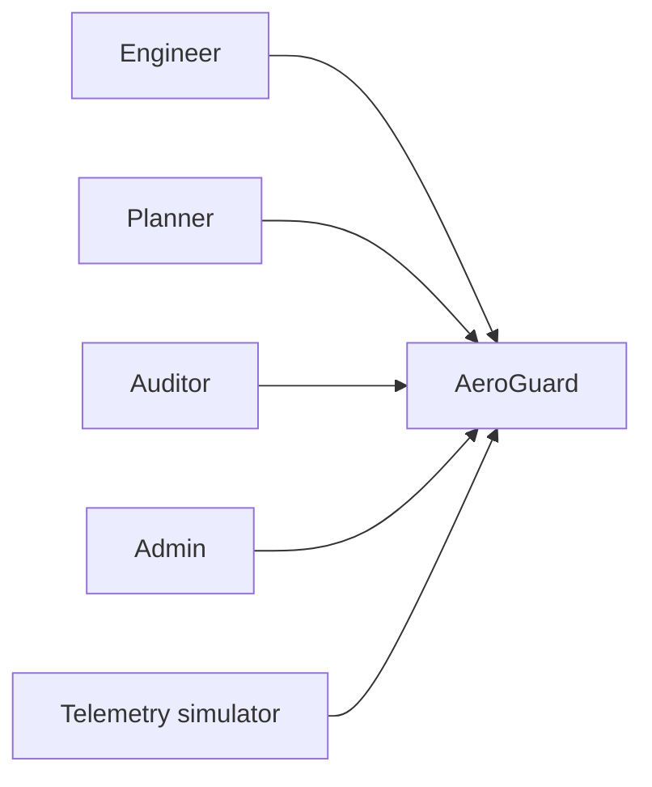
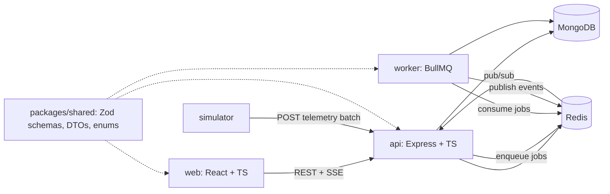
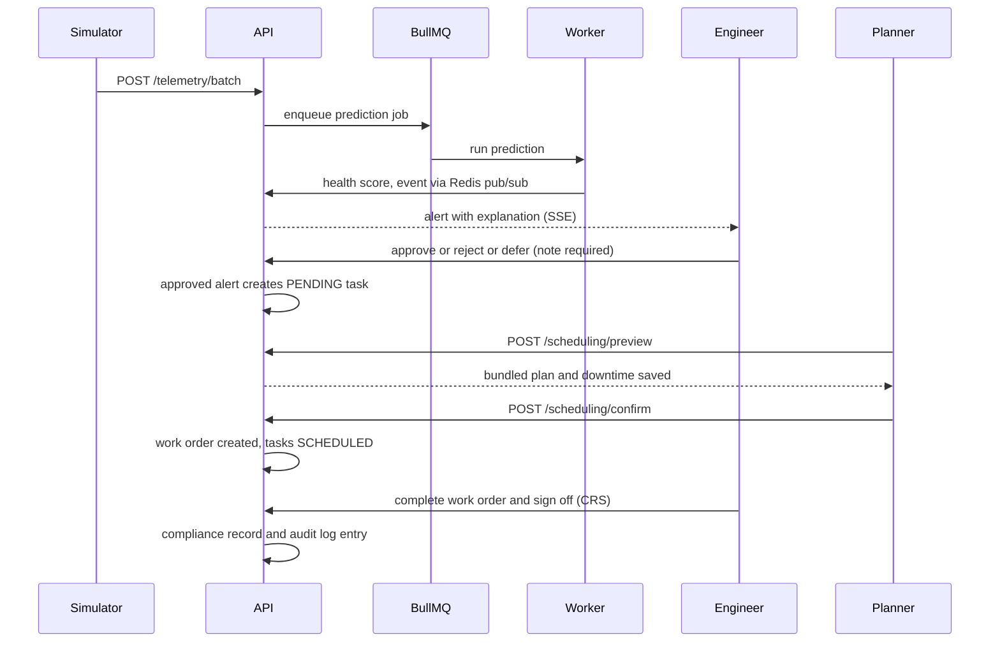

# 04. Architecture

AeroGuard is a modular monolith (see ADR 0001). All telemetry comes from a simulator with fictional aircraft.

## 1. System context

## 2. Containers

## 3. Core loop: Predict, Plan, Comply

Every state change writes an append-only audit log entry (ADR 0007).

## 4. How `packages/shared` is built and consumed

- `packages/shared` is an npm workspace (`@aeroguard/shared`) written in TypeScript and compiled to `dist/` with `tsc`.
- `api`, `worker` and `simulator` list it as a dependency (`"*"`), and npm links it into `node_modules` through workspaces.
- The root `npm run build` builds `shared` first, then the other apps, so they always import compiled output.
- `web` consumes it the same way once it is added in Chunk 1B (Vite resolves the workspace package).
- Docker builds use the repo root as build context so `packages/shared` is available (project rule 11).

## 5. Module boundaries

API modules: auth, users, fleet, components, telemetry, health, alerts, tasks, scheduling, workorders, compliance, reports, audit. Each has routes, controller, service, schema and tests. A module calls another module's service, never its model. Layering: route, validation middleware, controller, service, model.